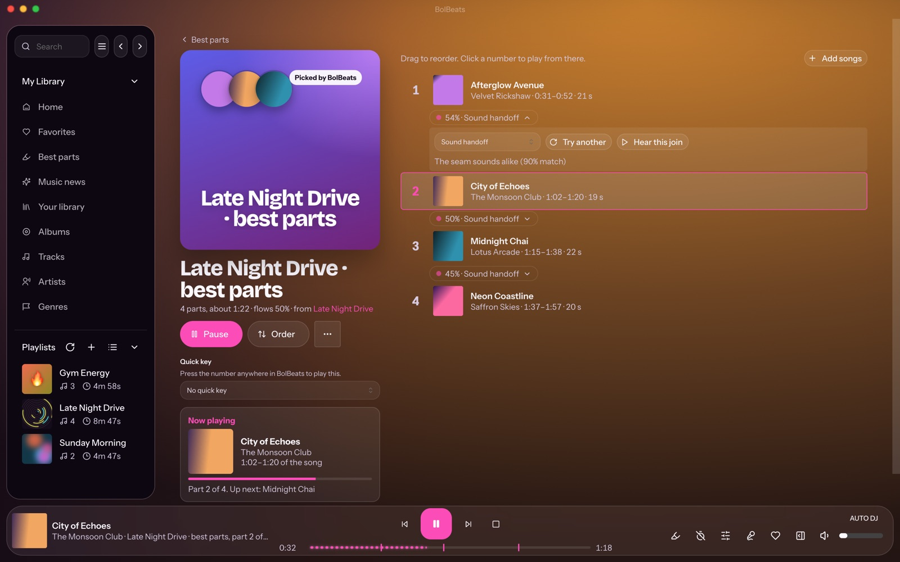
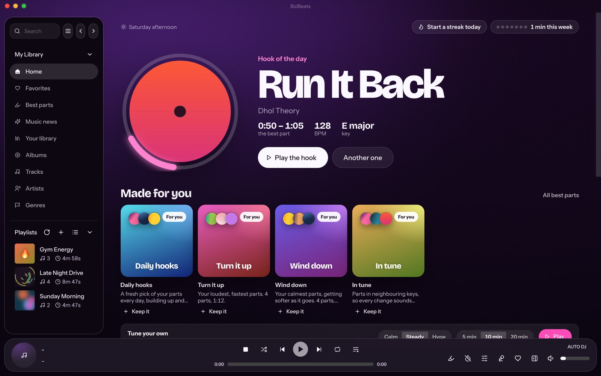
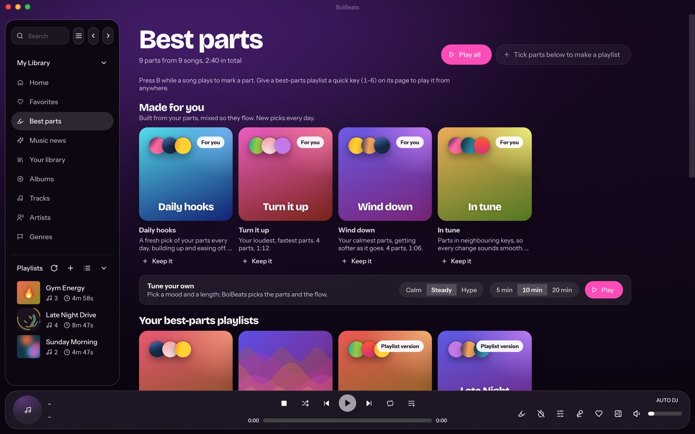
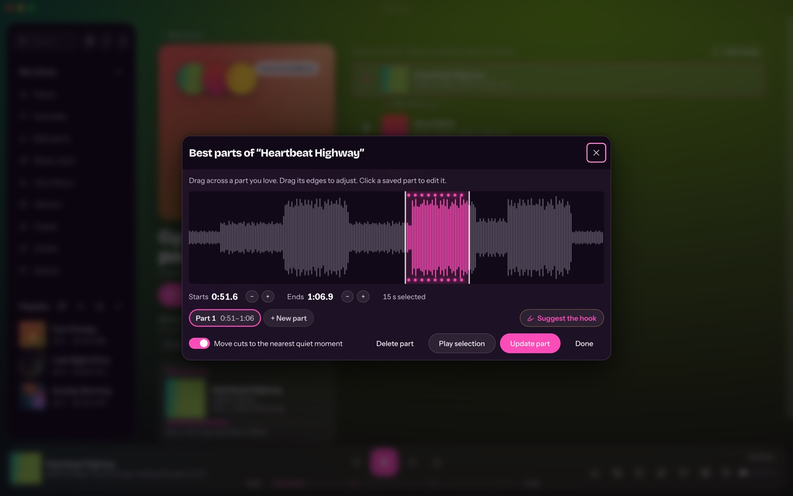

<h1 align="center">BolBeats</h1>

<p align="center"><b>The Mac music player that plays the best part of every song.</b><br>
It finds the hook of each song in your library and mixes them back to back, like a DJ who only plays the good bits.</p>

<p align="center">
  <a href="https://github.com/itsrocksome/bolbeats/releases/latest"></a>
  <a href="https://github.com/itsrocksome/bolbeats/releases"></a>
  
  <a href="LICENSE"></a>
  <a href="https://hits.sh/github.com/itsrocksome/bolbeats/"></a>
</p>

<p align="center"></p>

You know the moment: the beat drops, the hook lands, the chorus you wait three minutes for. BolBeats finds that part in every
song on your Mac and plays them one after another as a single seamless mix. No account, no ads, no tracking. Your music
stays on your Mac.

## Download

**[Download BolBeats for Mac (Apple Silicon)](https://github.com/itsrocksome/bolbeats/releases/latest/download/BolBeats-mac-arm64.dmg)**

BolBeats needs a Mac with Apple Silicon (M1 or later). Not sure? Apple menu > About This Mac: it says "Chip" on Apple
Silicon Macs.

**First launch.** Open the DMG and drag BolBeats into Applications. BolBeats is free and is not yet signed with a paid
Apple developer certificate, so the first time you open it macOS may say it can't check the app. Go to
**System Settings > Privacy & Security**, scroll down and click **Open Anyway**. You only do this once.

BolBeats plays the music files on your Mac (MP3, M4A, FLAC, WAV, OGG and more). Put your songs in `~/Music` (folders are
fine) or pick any folder in **Your library**.

## What it does

### Best parts, found for you
- **Every best part of every song, found automatically.** BolBeats listens to each song and finds its hook (usually the
  chorus: the section that repeats, is loudest and busiest), then every other section that sounds different and stands
  out nearly as much, like a drop or a second hook. Some songs get one part, some get several; the song decides. Parts
  are cut on the beat at a quiet moment and are as long as the section really is (25 seconds or more, no upper limit),
  rounded to whole musical phrases.
- **Or mark your own.** Press <kbd>B</kbd> while a song plays to mark where your part starts and again where it ends, or drag
  across the song's waveform. A song can have as many parts as you like.
- **Best parts only.** Flip one switch in the player bar and anything you play (an album, an artist, a search, your queue)
  plays just each song's best parts, then moves on. Flip it back for full songs.
- **Make the best-parts version of any playlist** in about half a second per song, or pick the parts yourself song by
  song and let BolBeats arrange them.
- **It learns your taste.** Thumbs up or down on the playing part, skip what you don't like, trim or stretch a part:
  BolBeats learns how long you like your parts and where they should start, and leaves out the ones you keep skipping.
  It all stays on your Mac.

### Mixed like a DJ
- **Best-parts playlists** play only the parts, joined with transitions chosen from each part's tempo and key: beat blend,
  filter sweep, bass swap, echo out, cut on the beat and more. Every join shows how well the two parts fit.
- **Smoothest flow** puts parts in the order that joins best. **Mashup** lets songs take turns (A1, B2, A2, B1...) wherever
  they fit, and never plays a song backwards. When songs have several parts, BolBeats arranges them this way by itself.
- Hear any join on its own, try another transition, drag parts into any order, add songs, and save the mix as a WAV file.
- **Share a mix.** Send a best-parts playlist with AirDrop, Messages or Mail as a tiny `.bolbeats` file. It holds no
  audio: whoever opens it in BolBeats gets the same playlist, built from their own copies of the songs.
- **Made for you:** Daily hooks, Turn it up, Wind down, In tune and Thumbs up are rebuilt from your parts every day, plus a hook of the day.

### Your folders are your library
- **Every folder of songs becomes a playlist** with the folder's name. New songs dropped in join it automatically.
- **No duplicates.** A song saved in two folders shows once and both playlists point to it. Nothing is moved or deleted.
- **Search everything**, and artists tagged like "Artist A/Artist B" are split into real artists.
- **Song details and covers filled in** for songs that miss them, from free lookups that send only the song title and
  artist. Every change is backed up and can be undone.
- **Ten free starter songs** so a new library is never empty: two playlists and their best-parts versions are ready on
  the first launch. Remove them from Your library when your own music is in; that deletes them and frees the space.

### And more
- Custom playlist covers: generated art, emoji, or your own picture.
- Quick keys: press 1 to 6 anywhere to play a best-parts playlist.
- Music news: new releases from the artists you listen to.
- The "Glow" look: the playing song's cover becomes the colour of the whole window.
- Everything from [Feishin](https://github.com/jeffvli/feishin), the open-source player BolBeats is built on: queue, lyrics,
  smart playlists, scrobbling, themes and more.

<p align="center">
  
  
</p>
<p align="center"></p>

## Private by design
- No account, no analytics, no ads, no auto-updates.
- Your music never leaves your Mac. BolBeats' music library is built in: it reads your music folder and answers only
  this Mac, on `127.0.0.1`, behind a login only the app knows.
- The only online requests are optional song-detail lookups (song title and artist) and release checks for your artists.

## How it works
- **Library.** BolBeats reads your music folder itself (tags and covers through TagLib), keeps a small index next to
  its settings, and notices new, changed, moved or deleted songs on its own. A song you move or rename keeps its best
  parts and plays.
- **Finding the hook.** Each song is turned into a timeline of harmony (chroma) and sound colour (MFCC) features. A
  self-similarity map shows which moments repeat (mutual nearest neighbours), a novelty curve shows where sections change,
  and beat tracking places the cut. It runs off the main thread, two songs at a time.
- **Mixing.** Each part is cut straight out of its MP3 by whole frames, with no re-encoding and sample-exact timing, so a
  22-part mix starts in under half a second. Transitions are scheduled with the Web Audio API, with a limiter so loud
  joins never clip.

## FAQ

**Is there a music player that plays only the chorus or best part of each song?**
Yes, that is exactly what BolBeats does. It finds the chorus of every song in your library and can play only those parts,
mixed together.

**Can I make a DJ mix or mashup from my own MP3s on a Mac?**
Yes. Make a best-parts playlist, choose Mashup order to let songs take turns, adjust any transition, and save it as a WAV file.

**Does it work with Spotify or Apple Music?**
No. Streaming services don't allow their music to be cut up and mixed by other apps. BolBeats plays music files you have
on your Mac.

**Is it free?** Yes, free and open source under the GPL-3.0 licence.

**Windows or Linux?** There is a first Windows build (64-bit Windows 10 and 11). It is newer and less tested than the Mac
version, so please report anything odd. Linux: build from source.

## Build from source

You need Node.js 24 or later, [pnpm](https://pnpm.io) and, for the audio tests, ffmpeg.

```bash
git clone https://github.com/itsrocksome/bolbeats.git
cd bolbeats
pnpm install
pnpm run dev
```

Make the DMG:

```bash
pnpm run build
pnpm exec electron-builder --mac dmg --arm64 --publish never
```

Checks: `pnpm run lint` (types, code and styles) and `node --test test/*.test.ts`.

## Credits
- [Feishin](https://github.com/jeffvli/feishin) by jeffvli and contributors, the player BolBeats is built on (GPL-3.0).
- [TagLib](https://github.com/taglib/taglib) through [taglib-wasm](https://github.com/CharlesWiltgen/taglib-wasm), which
  reads tags and covers. Versions 1.0 to 1.5 bundled [Navidrome](https://github.com/navidrome/navidrome) (GPL-3.0) as the
  library; BolBeats' own library replaced it and speaks the same API, so the app's screens did not change.
- Fonts: [Bricolage Grotesque](https://fonts.google.com/specimen/Bricolage+Grotesque) and
  [Instrument Sans](https://fonts.google.com/specimen/Instrument+Sans) (SIL Open Font License).
- Starter songs: The Entertainer, Maple Leaf Rag, Canon in D Major, Dance of the Sugar Plum Fairy, Gymnopedie No 1,
  Monkeys Spinning Monkeys, Sneaky Snitch, Carefree, Life of Riley and Fluffing a Duck by Kevin MacLeod
  ([incompetech.com](https://incompetech.com)), licensed under
  [Creative Commons: By Attribution 4.0](https://creativecommons.org/licenses/by/4.0/). Re-encoded to 160 kbps, retagged,
  cover art added.
- Song details from [iTunes Search](https://performance-partners.apple.com/search-api), [MusicBrainz](https://musicbrainz.org)
  and the [Cover Art Archive](https://coverartarchive.org).

## License

[GPL-3.0](LICENSE). BolBeats is a fork of Feishin and keeps its licence.
